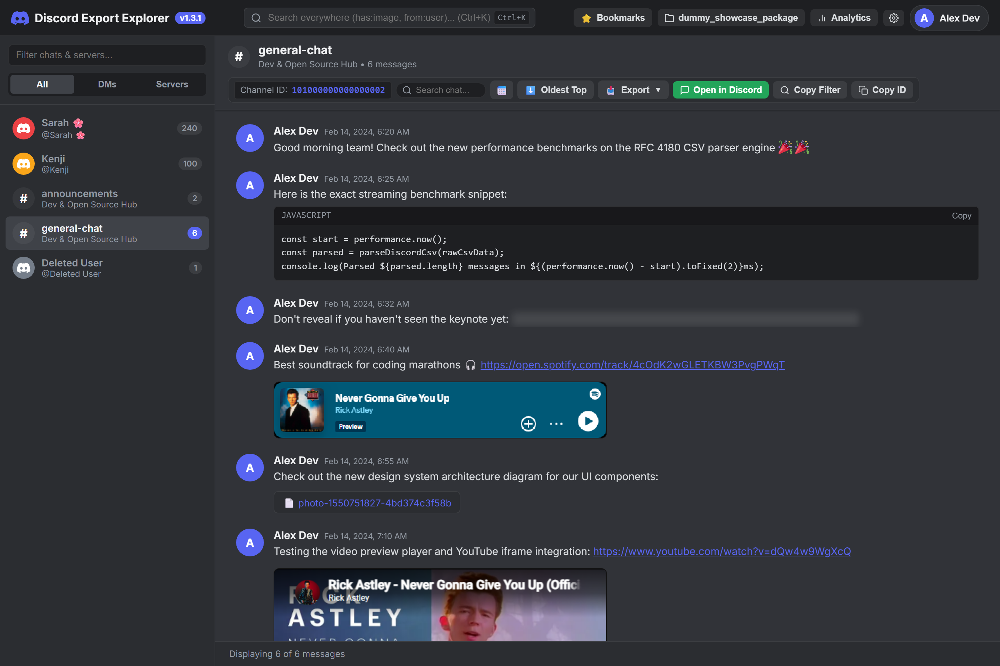
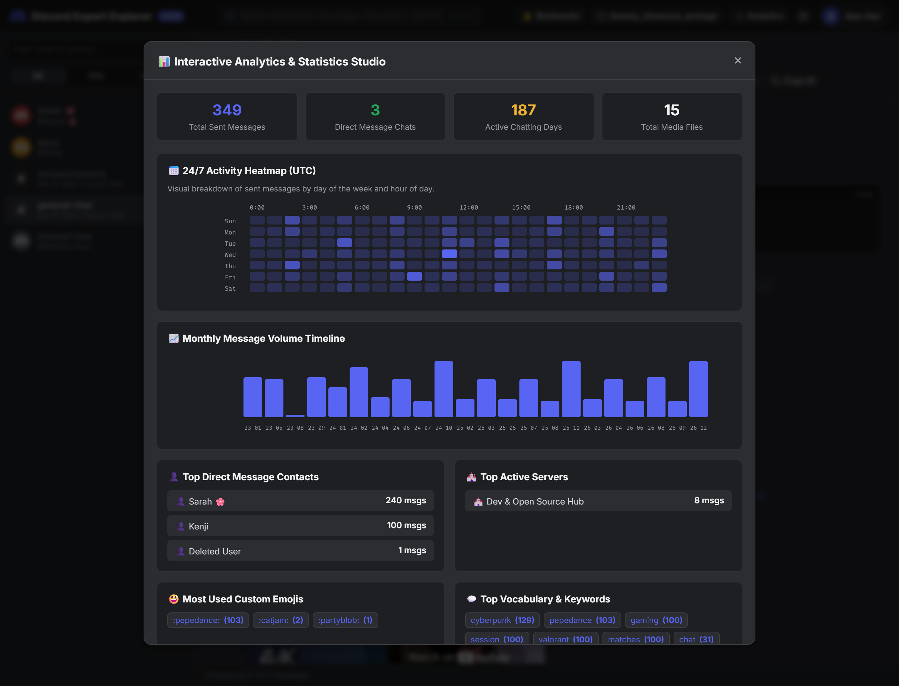
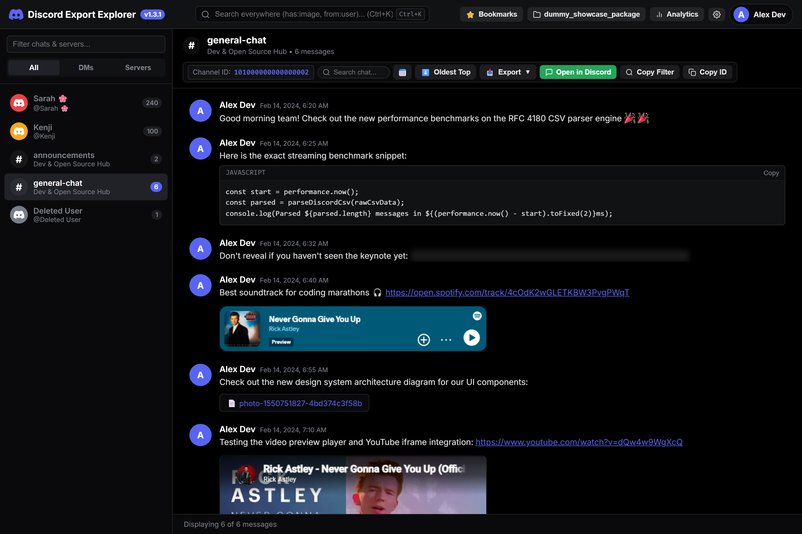
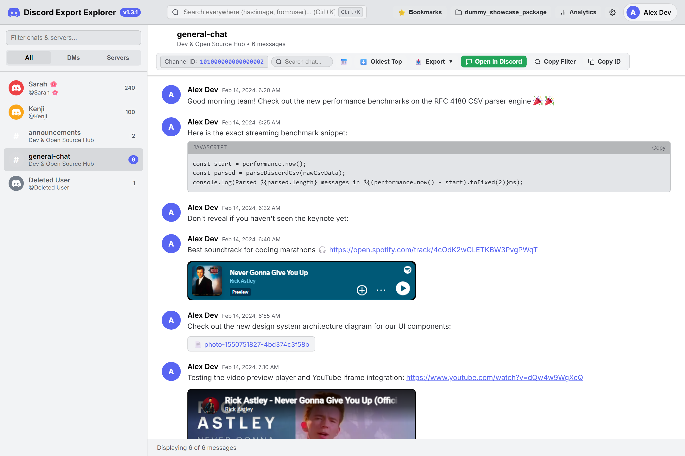
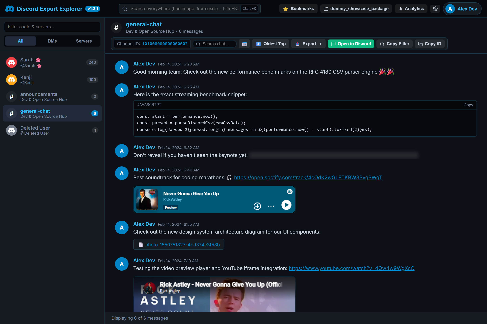
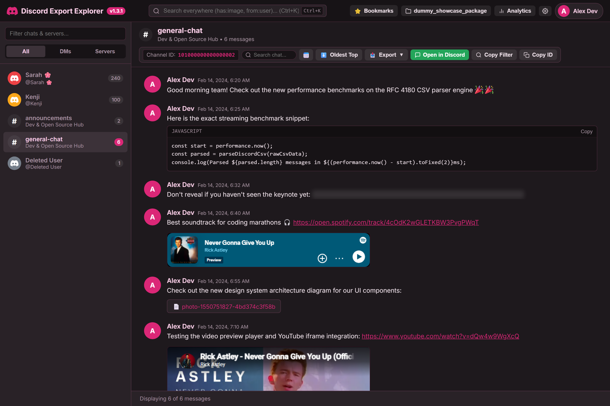

# 💬 Discord Data Export Explorer

[](#-features)
[](https://opensource.org/licenses/MIT)
[](https://nodejs.org/)
[](https://python.org/)
[](#-automated-testing)
[](#-privacy--security)

> A lightweight, feature-rich desktop application and web explorer to easily browse, search, analyze, and navigate your unzipped **Discord Data Package** exports with an authentic Discord-styled UI, direct profile launch shortcuts, user ID tag export tools, full media lightbox, interactive analytics, and multi-format offline chat exporters.

---

## 📸 Interface Preview

### Main Chat Explorer View (Default Dark Theme)


### Export Analytics & Message Statistics Studio


### 🎨 Complete Theme Showcase (Non-Default Themes)

| 🖤 Midnight AMOLED | ☀️ Discord Light |
| :---: | :---: |
|  |  |
| **🌌 Cyberpunk Neon** | **🌸 Sakura Pastel** |
|  |  |

---

## 🌟 Key Features

- **💬 Authentic Discord Design & Themes**:
  - 🌙 **Dark** (Default Discord `#313338`)
  - 🖤 **Midnight** (AMOLED Black)
  - ☀️ **Light** (Clean Light Mode)
  - 🌌 **Cyberpunk** (Neon Glow)
  - 🌸 **Sakura** (Pastel Rose)
  - Cozy vs Compact display density modes & adjustable font sizes.
- **✨ Full-Fidelity Discord Markdown & Custom Emojis**:
  - Custom animated and static Discord emojis (`<a:name:id>` & `<:name:id>`) rendered crisp from CDN.
  - Interactive click-to-reveal spoilers (`||secret text||`).
  - Discord relative & absolute formatted timestamps (`<t:1700000000:R>`).
  - Channel mentions (`<#channel_id>`) with instant jump-to-channel.
  - User mentions (`<@id>`), role mentions (`<@&id>`), subtext (`-# text`), blockquotes, headers, and codeblocks with one-click copy buttons.
- **🖼️ Rich Media Lightbox & Gallery**:
  - Fullscreen zoomable/rotatable image lightbox with next/previous gallery carousel navigation across the channel.
  - Inline video players, custom audio players, and document attachment links.
  - Responsive **YouTube** and **Spotify** interactive media embeds.
- **⚡ Multi-Format Discord Package Parsing (JSON + CSV)**:
  - Native RFC 4180 CSV engine for packages containing `messages.csv` alongside standard `messages.json`.
  - Sub-second indexing across hundreds of channels and 100,000+ messages.
- **🔍 Advanced Cross-Chat Search & Filtering**:
  - Search operators: `from:me`, `from:<user>`, `has:image`, `has:video`, `has:audio`, `has:file`, `has:link`, `before:YYYY-MM-DD`, `after:YYYY-MM-DD`.
  - In-chat search with match count indicator (`Match 1 of 14`) and `▲` / `▼` smooth jump controls.
- **⭐ Starred & Bookmarked Messages Hub**:
  - Star favorite messages with `localStorage` persistence and single-click jump back to any conversation.
- **📊 Interactive Analytics Studio**:
  - **24/7 Activity Heatmap**: Interactive SVG matrix mapping sent messages by hour of day and day of week.
  - **Monthly & Yearly Volume Timeline**: Visual bar chart of chatting activity over time.
  - **Top Contacts & Servers Leaderboards**: Activity rankings with message volume distribution.
  - **Vocabulary & Emoji Clouds**: Frequency breakdown of most used words and custom emojis.
- **📦 Multi-Format Offline Exporter**:
  - Export entire chat histories to **Standalone Styled HTML** (fully styled Discord dark mode, shareable offline), **CSV**, **JSON**, and **Plain Text (TXT)**.
  - Bulk export all DM contact User IDs in one click.
- **👤 Profile & Connected Accounts Viewer**:
  - View full account metadata, Nitro status, account creation date, and connected accounts (GitHub, Spotify, Steam, Twitch, YouTube, Xbox, PlayStation).
- **🚀 Native Discord Direct Launch**:
  - One-click **`Open in Discord`** (`discord://-/channels/@me/{channel_id}`) to jump directly into the exact conversation natively inside Discord.
  - **`Profile`** button (`discord://-/users/{user_id}`) to open recipient profile cards natively.
- **🛡️ Deleted User ID Log Recovery**: Automatic background recovery of deleted account IDs from activity logs and message attachment telemetry.
- **🖥️ Standalone Windows Desktop Launcher**: Single executable launcher and cross-platform Python GUI.
- **🔒 100% Private & Local**: Runs entirely on your local machine (`localhost`). Zero external servers, zero telemetry, zero data collection.

---

## 🚀 Quick Start Guide

### Option 1: Standalone Windows Executable (GUI Launcher)

1. Download **`DiscordDataExportExplorer.exe`** from [Releases](https://github.com/BrannonSD/discord-data-export-explorer/releases).
2. Run **`DiscordDataExportExplorer.exe`**.
3. Click **`Browse...`** and select your unzipped Discord Data Package folder (containing `Account`, `Messages`, `Servers`).
4. Click **`🚀 Launch Explorer in Browser`**. The web dashboard will open in your browser at `http://localhost:3000`.

---

### Option 2: Command Line (Node.js)

1. Clone the repository:
   ```bash
   git clone https://github.com/BrannonSD/discord-data-export-explorer.git
   cd discord-data-export-explorer
   ```

2. Install dependencies:
   ```bash
   npm install
   ```

3. Launch server with your export folder path:
   ```bash
   node server.js --package "C:/path/to/your/unzipped/package"
   ```

4. Open your browser to `http://localhost:3000`.

---

### Option 3: Python GUI Launcher (Cross-Platform)

Run the included Python GUI script (requires Python 3.8+):
```bash
python gui_launcher.py
```

---

## ⌨️ Keyboard Shortcuts

| Shortcut | Action |
| :--- | :--- |
| `Ctrl + K` or `Ctrl + F` | Open Global Cross-Chat Search |
| `Ctrl + Shift + S` | Open Interactive Analytics Studio |
| `Ctrl + Shift + B` | Open Starred Bookmarks Hub |
| `Esc` | Close open modal / Lightbox / Clear search |
| `◀` / `▶` | Navigate Lightbox Gallery |
| `+` / `-` | Zoom In / Zoom Out in Lightbox |

---

## 🧪 Automated Testing

The project includes an exhaustive automated test suite covering all API endpoints, CSV & JSON parsers, markdown engine, deleted user recovery, and Python/Node feature parity.

Run the test suite:
```bash
npm test
python tests/test_gui_launcher.py
```

---

## 📥 How to Get Your Discord Data Package

1. In Discord, go to **User Settings** (⚙️ cog icon).
2. Navigate to **Privacy & Safety**.
3. Scroll down to **Request all of my data** and click **Request Data**.
4. Discord will email you a link to download your `.zip` data package (usually within 24-48 hours).
5. Extract the `.zip` archive to a folder on your computer and select that folder in **Discord Data Export Explorer**.

---

## 🔒 Privacy & Security

Your privacy is paramount. **Discord Data Export Explorer**:
- Runs 100% locally on your own computer (`localhost:3000`).
- Does **NOT** send any data to external servers or APIs.
- Does **NOT** track usage, analytics, or IP addresses.
- Your message data never leaves your disk.

---

## 🛠️ Tech Stack

- **Backend**: Node.js (Express) / Python HTTP Server (Embedded Standalone)
- **Frontend**: Vanilla HTML5, CSS3 (Multi-Theme Discord Glassmorphism Design System), JavaScript (ES6+)
- **Desktop Launcher**: Single Executable (`DiscordDataExportExplorer.exe`) & Python Tkinter GUI (`gui_launcher.py`)

---

## 📄 License

This project is licensed under the [MIT License](LICENSE).

Developed with ❤️ by [BrannonSD](https://github.com/BrannonSD).
